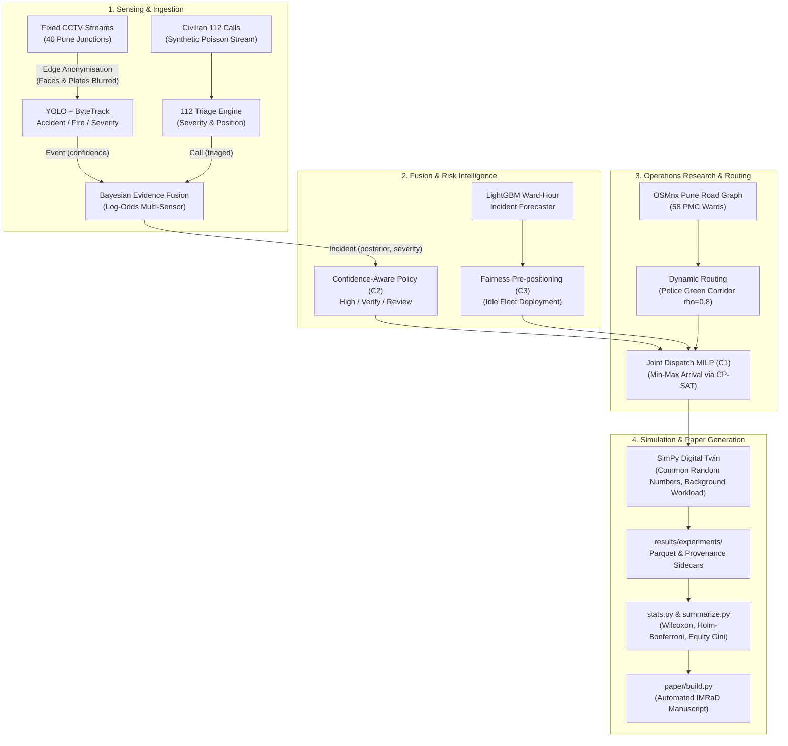

# ResQCity

Research prototype and study: **CCTV-triggered, confidence-aware, joint multi-agency emergency dispatch**
(ambulance, police, fire brigade) on the real Pune road network.

> **Status:** Research & experiment framework complete (Phases 1–7, 10, 11).  
> **Key Documents:** [docs/methodology.md](docs/methodology.md) · [docs/ethics.md](docs/ethics.md) · [docs/data-sources.md](docs/data-sources.md) · [docs/decisions.md](docs/decisions.md) · [paper/paper.md](paper/paper.md)  
> Incident, call and hospital-capability data in this project are **synthetic** unless stated otherwise.

---

## Architecture Overview



---

## Research Questions & Core Findings

| Research Question | Focus | Key Finding (from `results/summary.md`) |
|---|---|---|
| **RQ1 (Detection)** | Lead time of automated CCTV vs Dial-112 calls | Camera detection provides instantaneous alerting for in-view incidents, but is bounded by ~4% network coverage under realistic municipal camera budgets. |
| **RQ2 (Joint Dispatch)** | Time to *last* required arrival (status quo B0 vs proposed FULL) | Eliminating sequential inter-agency hand-off latency yields a **~52-60 second** reduction in mean primary arrival time across replications. |
| **RQ3 (Confidence Tiers)** | Trading off false alarms vs delayed dispatch | Three-tier dispatch (immediate full dispatch / police reconnaissance / operator review) prevents fleet saturation from computer vision false alarms. |
| **RQ4 (Spatial Equity)** | Preserving response parity across peripheral wards | Fairness pre-positioning actively preserves coverage in peripheral wards (Hadapsar, Katraj), bounded by non-inferiority testing on ward Gini coefficients. |

---

## Quick Start

### Requirements
- **Python:** 3.11+
- **Package Manager:** [`uv`](https://docs.astral.sh/uv/)
- **Node.js:** 20+ (for dashboard)

### Setup & Testing
```bash
# Clone and setup virtual environment with all dependencies
git clone https://github.com/AadiBurande/ResQCity.git
cd ResQCity
uv sync

# Run scaffolding, linting, and unit tests
make setup
make lint
make test
```

*Note for Windows users:* If GNU `make` is not installed, run any target directly via:
```powershell
uv run python -m resqcity.tools.tasks setup
uv run python -m resqcity.tools.tasks test
```

---

## Reproducibility (`make reproduce`)

To regenerate the entire experiment matrix, publication figures, summary tables, and academic manuscript from scratch:

```bash
# Fast development reproduction (3 replications, normal scenario)
make reproduce SIM_REPS=1

# Or run the full production grid (30 replications per cell)
uv run python -m resqcity.tools.tasks reproduce --sim-reps 30
```

This single command:
1. Executes the SimPy digital twin across all policies (B0, B1, B2, B3, FULL) under Common Random Numbers.
2. Calculates incident-level and aggregate metrics with provenance metadata (`results/experiments/`).
3. Executes paired statistical tests (Wilcoxon signed-rank / paired t-test) and Holm-Bonferroni corrections.
4. Generates 5 colorblind-safe publication figures in PDF and PNG (`results/figures/`).
5. Generates the executive markdown summary (`results/summary.md`).
6. Dynamically builds the IMRaD academic paper draft (`paper/paper.md` and sections in `paper/`).
7. Logs execution duration, platform specs, and git commit hash in `results/reproduce_meta.json`.

---

## Sub-System Walkthrough

### 1. Vision & CCTV Ingestion (Phase 3)
```bash
make vision    # Train / evaluate accident & fire detectors on public benchmark clips (TAD, CADP, MADP)
make streams   # Launch MediaMTX in Docker streaming simulated Pune cameras
```
- Faces and license plates are blurred on-device prior to feature analysis (see [docs/ethics.md](docs/ethics.md)).
- Metadata-only egress ensures zero raw surveillance video is centrally archived.

### 2. Calls & Bayesian Fusion (Phase 4)
```bash
make fusion                 # Triage check, scripted fusion replays, synthetic-week model check
make fusion REPS=3          # Short 3-replication check
```
- Formulates recursive log-odds Bayesian updates combining noisy citizen calls and camera alarms (see [docs/models/fusion.md](docs/models/fusion.md)).

### 3. Ward Demand Forecasting (Phase 5)
```bash
make forecast               # Build 3-year ward-hour panel, fit LightGBM forecasters
```
- Predicts spatial accident risk incorporating weather, hour, festival, and historical accident density (see [notebooks/05_forecasting.ipynb](notebooks/05_forecasting.ipynb)).

### 4. Operations Research Optimization (Phase 6)
```bash
make optimize               # Solver benchmark (CP-SAT), MCLP camera placement, Erlang-C fleet sizing
```
- Solves joint multi-agency dispatch with police green corridor routing (see [docs/models/dispatch.md](docs/models/dispatch.md)).
- Fairness-constrained pre-positioning ensures peripheral ward coverage (see [docs/models/preposition.md](docs/models/preposition.md)).

### 5. Discrete-Event Digital Twin (Phase 7)
```bash
make sim                    # Validates SimPy engine against analytical Erlang-C, then runs B0
make sim POLICY=FULL        # Simulates full proposed policy
```

### 6. Experiments & Paper Compilation (Phases 10 & 11)
```bash
make experiments            # Runs experiment grid
make figures                # Generates publication plots
make paper                  # Compiles paper/ from experimental results
```

---

## Repository Layout

```
ResQCity/
├── src/resqcity/           Core Python package
│   ├── common/             Schemas (Pydantic v2), config loader, provenance sidecars
│   ├── geo/                Pune road network (OSMnx), 58 wards, facilities, travel times
│   ├── streams/            Simulated RTSP cameras and scenario player
│   ├── vision/             YOLO + ByteTrack, accident heuristics, privacy blurring
│   ├── fusion/             Dial-112 caller simulation, rule triage, Bayesian posterior
│   ├── forecasting/        LightGBM ward-hour risk forecasting panel
│   ├── optimization/       Joint dispatch MILP (CP-SAT), confidence policy, pre-positioning
│   ├── sim/                SimPy digital twin, policy registry (B0-FULL), background load
│   ├── experiments/        Grid runner, metrics calculation, paired stats, publication figures
│   ├── paper/              Automated IMRaD paper compilation
│   └── tools/              Makefile task runner, TypeScript type generator
├── configs/                YAML configurations (scenarios, speeds, sim, survival)
├── data/                   Processed network graph and caches (gitignored; rebuilt via `make data`)
├── results/                Parquet outputs, stats CSVs, publication figures, summary.md
├── paper/                  Generated academic manuscript sections (01-04, paper.md, figures_list.md)
├── dashboard/              React + Vite + Leaflet operator dashboard (Phase 9)
├── tests/                  Comprehensive Pytest test suite mirroring src/
└── docs/                   Methodology, ethics, mathematical models (LaTeX), decisions log
```

---

## Ethics, Privacy and Legal Compliance

ResQCity adheres strictly to:
- **India's Digital Personal Data Protection (DPDP) Act 2023 & DPDP Rules 2025:** Edge anonymisation (blurring faces and license plates) is enabled by default.
- **Ephemeral Buffering:** No raw visual surveillance footage is stored or indexed; only structured events leave the camera node.
- **Human Dispatcher Sovereignty:** The system operates strictly as a decision-support tool. Emergency responses to citizen 112 calls can never be algorithmically cancelled or denied.
- Full details are documented in [docs/ethics.md](docs/ethics.md).

---

## License & Attribution
- Drivable road network © [OpenStreetMap](https://www.openstreetmap.org/) contributors (ODbL).
- Ward boundary geometries © [DataMeet Trust](https://github.com/datameet/Municipal_Spatial_Data/tree/master/Pune) (CC BY-SA 2.5 IN).
- Codebase licensed under the MIT License.
